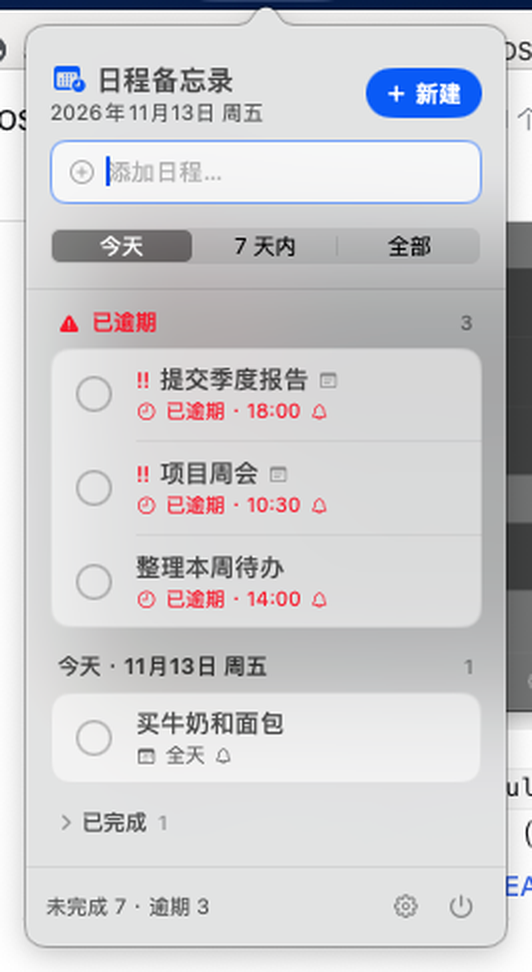
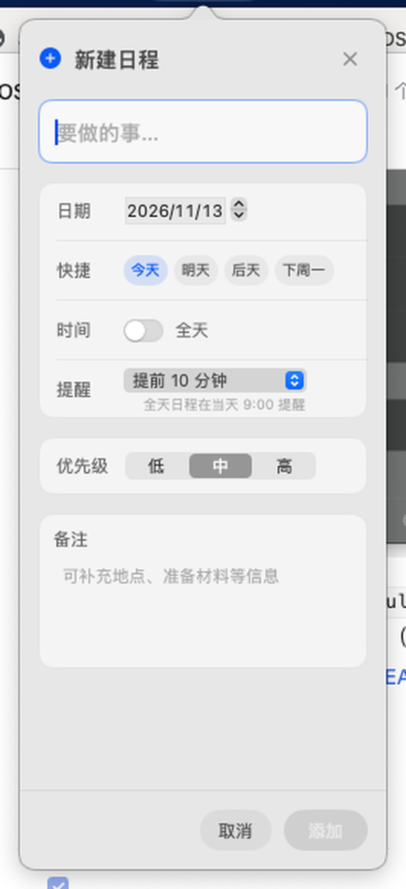
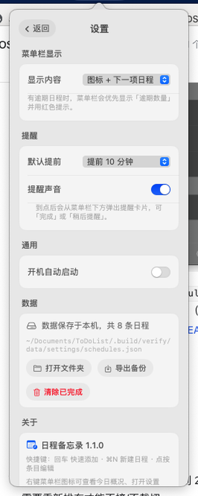
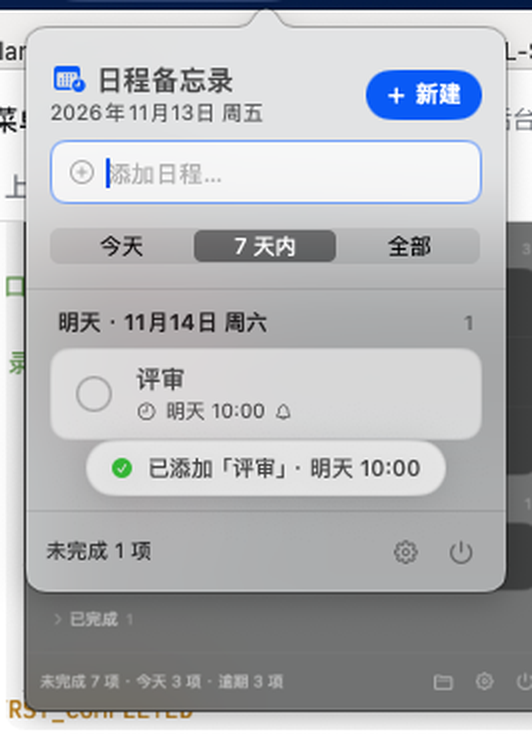
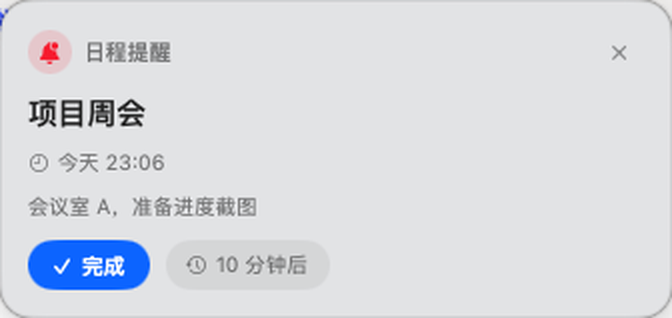
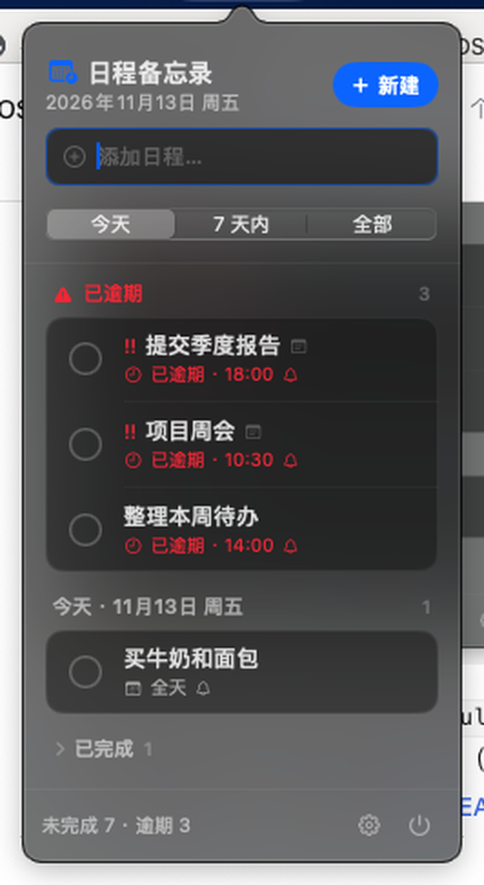

# 日程备忘录 · ScheduleMemo

[](https://github.com/ZhenwenZhang/ScheduleMemo/releases/latest)
[](#)
[](LICENSE)

一个为本机 macOS 定制的**菜单栏日程应用**：常驻菜单栏，点开图标即可查看、添加、修改日程，到点弹出提醒。全部数据保存在本地，不联网、不需要账号。

当前版本 v1.2.0（2026-11-24）。通用二进制，Apple Silicon 与 Intel 均可运行。



| 新建 / 编辑 | 设置 |
| --- | --- |
|  |  |

| 快捷添加 | 到点提醒 |
| --- | --- |
|  |  |

深色模式自动适配：



## 下载安装

前往 **[Releases](https://github.com/ZhenwenZhang/ScheduleMemo/releases/latest)** 下载 `ScheduleMemo-1.2.0.dmg`：

1. 双击打开 DMG，把 `ScheduleMemo.app` 拖进 `Applications`；
2. 打开「应用程序」里的「日程备忘录」，菜单栏右上角出现清单图标；
3. 首次打开若提示「无法验证开发者」（应用未做 Apple 公证）：
   - 在 Finder 里**右键点击 App → 打开**，再确认一次即可；
   - 或执行：`xattr -dr com.apple.quarantine /Applications/ScheduleMemo.app`
4. 如需开机自启：点开面板 → 齿轮「设置」→ 打开「开机自动启动」。

校验下载文件：

```bash
shasum -a 256 -c ScheduleMemo-1.2.0.dmg.sha256
```

数据只保存在本机 `~/Library/Application Support/ScheduleMemo/`，不会上传到任何服务器。

## 功能

- **菜单栏常驻**：默认只在菜单栏显示清单图标，不显示任何文字，尽量不占空间；需要时可在「设置 → 菜单栏显示」切换成「下一项日程」或「今日待办数」。
- **点开即用**：左键点图标弹出面板，右键弹出快捷菜单（打开面板 / 新建 / 今日概况 / 设置 / 数据文件夹 / 退出）。
- **添加**：面板顶部输入框支持中文自然语言，写「明天 10:00 交报告」回车即可；也可以点「新建」填完整表单。
- **修改**：点任意一条日程打开编辑表单，可改日期、时间、备注、优先级、提醒。
- **日期信息**：按「已逾期 / 今天 / 明天 / 后天 / 具体日期」分组，行内显示时刻或「全天」，逾期红色标注。
- **完成与删除**：点圆圈标记完成，已完成收进「已完成」折叠区（保留 7 天）；悬停行可编辑/删除，右键菜单还可「稍后提醒」。删除和完成都支持底部提示条上的「撤销」。
- **提醒**：到点从菜单栏下方弹出提醒卡片，可「完成」或「10 分钟后」再提醒；全天日程默认当天 9:00 提醒；提示音可在设置里关闭。
- **筛选**：今天 / 7 天内 / 全部。
- **设置**：菜单栏显示样式、默认提醒时间、提醒声音、开机自动启动、打开数据文件夹、导出 JSON 备份、清除已完成（二次确认）。
- **本地数据**：JSON 明文存储，写入时自动保留一份备份；数据文件损坏会自动从备份恢复，并在面板里提示。
- **细节**：`Esc` 逐层关闭（表单 → 设置 → 面板）；失去焦点 / 点击其他应用自动收起；重复双击 App 不会开出两份，而是唤出已有窗口；深色模式自适应。

## 从源码构建

```bash
git clone https://github.com/ZhenwenZhang/ScheduleMemo.git
cd ScheduleMemo
./build.sh          # 编译通用二进制并打包 build/ScheduleMemo.app
./make_dmg.sh       # （可选）生成 build/ScheduleMemo-1.2.0.dmg
./install.sh        # 安装到 ~/Applications 并启动
```

也可以直接双击 `build/ScheduleMemo.app` 运行（无需安装）。首次打开后，菜单栏右上角会出现清单图标。

> 系统要求：macOS 14 及以上。已做 ad-hoc 签名、未做 Apple 公证：本机使用无碍，其他机器首次打开需右键 → 打开（见上文「下载安装」）。

## 使用

### 快速添加（自然语言）

在面板顶部输入框输入后按 **回车**，会即时解析日期与时间，输入框右侧会实时预览解析结果。

| 输入 | 解析结果 |
| --- | --- |
| `明天 10:00 交报告` | 明天 10:00 · 标题「交报告」 |
| `今天下午3点 和周总开会` | 今天 15:00 |
| `周五 上午9点半 复盘` | 最近的周五 09:30（若今天周五且已过点，则下周五） |
| `11月20日 提交材料` | 11 月 20 日全天 |
| `20号 交材料` | 本月/下月 20 日全天 |
| `12/25 圣诞聚会` | 12 月 25 日全天 |
| `3天后 取快递` | 三天后全天 |
| `下周一 9点 晨会` | 下周一 09:00 |
| `晚上8点 健身房` | 今天 20:00 |
| `明天 全天 团建` | 明天全天 |
| `买牛奶` | 今天全天（默认） |

没有写日期时默认今天；只写时间但今天已过点，则自动顺延到明天。

### 编辑与完成

- **点行** → 编辑表单（日期 / 快捷「今天·明天·后天·下周一」/ 具体时间 / 提醒提前量 / 优先级 / 备注）。
- **点左侧圆圈** → 标记完成；再点一次取消。
- **悬停行** → 右侧出现铅笔（编辑）和垃圾桶（删除）。
- **右键行** → 标记完成 / 编辑 / 稍后提醒 / 删除。
- 编辑表单里删除需要点两次「确认删除？」，防误触。

### 菜单栏显示与提醒

- 默认：菜单栏只显示清单图标，不显示日程文字或逾期数量。
- 需要更多信息时，可在「设置 → 菜单栏显示」切换为「下一项日程」（如 `14:00 项目周会`，逾期时红色显示数量）或「今日待办数」。
- 悬停菜单栏图标时，工具提示仍会显示下一项与逾期统计。
- 提醒只在应用运行时弹出；如果错过不久（定时日程 30 分钟内、全天日程 3 小时内）打开应用会补弹。

### 快捷键

| 操作 | 快捷键 |
| --- | --- |
| 快速添加 | 输入后按回车 |
| 新建日程 | `⌘N` |
| 保存表单 | `⌘↩` |
| 关闭 / 返回 | `esc`（先退出表单或设置，再收起面板） |

## 数据与备份

- 数据文件：`~/Library/Application Support/ScheduleMemo/schedules.json`（明文 JSON，可自行备份/迁移）
- 自动备份：同目录下 `schedules.backup.json`
- 从面板底部「文件夹」按钮可直接在 Finder 中打开；「设置 → 导出 JSON 备份」可另存一份。

## 构建、测试与验收

只用 macOS 自带的 Command Line Tools（`swiftc`），不需要完整 Xcode。

```bash
./build.sh     # 编译 arm64 + x86_64 通用 .app + 生成图标 + ad-hoc 签名
./tests.sh     # 纯逻辑单元测试（自然语言解析 / 分组 / 提醒时机 / 数据仓库，共 101 项断言）
```

开发验收（可选，需要 Python 与 RapidOCR）：

```bash
python3 -m pip install --target .build/pylibs rapidocr_onnxruntime
./tools/verify_ui.sh   # 启动真实 app，14 个场景截图 + OCR 校验（会短暂弹窗占屏，建议在独立会话/虚拟机运行）
```

验收通过的环境变量开关（仅开发用，正常使用不会触发）：

| 变量 | 作用 |
| --- | --- |
| `SCHEDULEMEMO_DATA_DIR` | 指定数据目录（测试隔离） |
| `SCHEDULEMEMO_SHOW_POPOVER_ON_LAUNCH=1` | 启动即展开面板 |
| `SCHEDULEMEMO_OPEN_EDITOR=1` / `SCHEDULEMEMO_OPEN_SETTINGS=1` | 展开后直接打开表单 / 设置 |
| `SCHEDULEMEMO_INITIAL_FILTER=today\|week\|all` | 指定初始筛选 |
| `SCHEDULEMEMO_TEST_REMINDER=1` | 弹出演示提醒 |
| `SCHEDULEMEMO_SMOKE_CLICK=1` | 模拟点击图标开关面板 |
| `SCHEDULEMEMO_SMOKE_TYPE=1` | 模拟键入「明天 10:00 评审」并回车 |
| `SCHEDULEMEMO_SMOKE_ESCAPE=1` / `SCHEDULEMEMO_SMOKE_ESCAPE_EDITOR=1` | 验证 Esc 收起面板 / 退出表单 |
| `SCHEDULEMEMO_DARK=1` | 强制深色外观（深色模式验收） |
| `SCHEDULEMEMO_DISABLE_AUTO_CLOSE=1` | 关闭"失焦 / 点外部自动收起"（自动化验收用） |
| `SCHEDULEMEMO_SMOKE_MENUBAR=1` | 依次切换三种菜单栏显示模式并回读状态 |
| `SCHEDULEMEMO_DEBUG_REPORT=<path>` | 输出窗口几何 / 状态快照 JSON |
| `SCHEDULEMEMO_AUTO_QUIT_SECONDS=<n>` | n 秒后自动退出 |

## 发布与同步（维护者）

发布新版本只需两步：

1. 修改 `Resources/Info.plist` 里的 `CFBundleShortVersionString` / `CFBundleVersion`；
2. 提交后执行：

```bash
./release.sh
```

脚本会：构建 **arm64 + x86_64 通用二进制** → 生成 DMG 与 SHA-256 → 推送 `main` 与 `vX.Y.Z` tag → 用 `gh` 创建 GitHub Release 并上传 DMG。

也可只在本机构建 DMG：

```bash
./build.sh && ./make_dmg.sh
```

## 项目结构

```
Sources/
  AppMain.swift           应用入口、窗口/键盘/单实例
  DevHooks.swift          仅开发验收用的环境变量钩子
  Models.swift            日程模型、日期文案、存储路径
  ScheduleLogic.swift     列表分组、统计、菜单栏文案（纯逻辑）
  QuickAddParser.swift    中文自然语言日期/时间解析
  TaskStore.swift         JSON 持久化、增删改查、备份恢复
  AppSettings.swift       偏好设置、开机自启、面板尺寸模型
  Theme.swift             配色与通用小控件
  PopoverView.swift       主面板（列表 / 筛选 / 快捷添加）
  EditorPanel.swift       新建 / 编辑表单
  SettingsPanel.swift     设置页
  StatusItemController.swift  菜单栏图标、弹出面板、右键菜单
  ReminderCenter.swift    到点提醒浮窗
Resources/Info.plist      LSUIElement=true（只在菜单栏出现）
tools/                    构建辅助、图标生成、UI 验收脚本
make_dmg.sh               DMG 打包脚本
release.sh                一键发布（构建 + tag + Release）
Tests/LogicTests/main.swift  逻辑单元测试
```

## 许可证

[MIT License](LICENSE) © 2026 ZhenwenZhang

## 已知限制

- 提醒依赖应用运行（菜单栏常驻即可）；应用完全退出时不会提醒。
- 开机自启依赖 `SMAppService`，请把 app 放在固定位置（如 `~/Applications`）后再开启，移动位置后需要重新开启一次。
- 日程不与其他系统日历（iCloud/Outlook）同步，只存本机；如需同步可导出 JSON。
- 单机自用应用，未做 App Store 沙箱与公证。