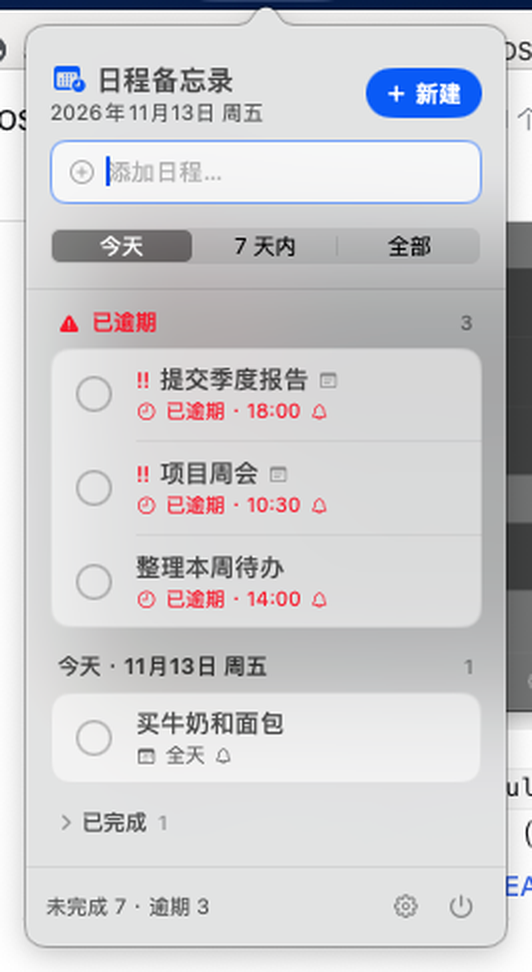

## 日程备忘录 v1.2.0



### 本次变更

- **菜单栏改为默认仅显示图标**：不再显示「下一项日程」文字或「N 项逾期」，菜单栏更干净、不占横向空间。
- 修复仅图标模式下，有逾期日程时仍会冒出文字的问题（现在严格只显示图标）。
- 仍可在「设置 → 菜单栏显示」切回「下一项日程」或「今日待办数」；悬停图标仍能看到下一项与逾期统计。
- 通用二进制（Apple Silicon / Intel），macOS 14+。

### 安装

1. 下载 `ScheduleMemo-1.2.0.dmg`，打开后把 `ScheduleMemo.app` 拖入 `Applications`；
2. 首次打开若提示「无法验证开发者」，请右键点击 App → 打开，或执行：
   `xattr -dr com.apple.quarantine /Applications/ScheduleMemo.app`。

### 校验

```bash
shasum -a 256 -c ScheduleMemo-1.2.0.dmg.sha256
```

### 源码

https://github.com/ZhenwenZhang/ScheduleMemo
